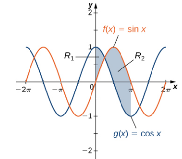
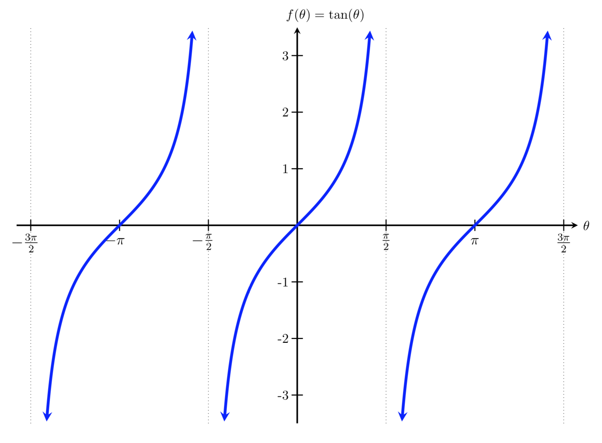

# AVP1357 — Single visual target

MathVista:287 / MathVista:661 · same type · Numeric representation and conversion

## Shared or similar visual information

The numerical notation π.

## Evidence locations

- Left image: The notation π appears on the positive horizontal axis below the right region.
- Right image: The notation π appears at the positive tangent zero on the horizontal axis.

## Mathematical meanings

Left image: π gives the horizontal coordinate at that tick. Right image: π gives the angle input at the marked positive zero.

## Same mathematical meanings

yes

## Rationales

The numeral gives the same horizontal coordinate in both images.

Only the selected target is annotated. AI visual-review draft; not independently double-annotated by humans.
