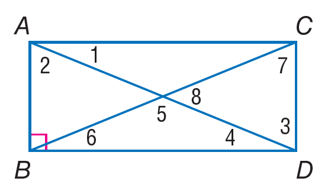
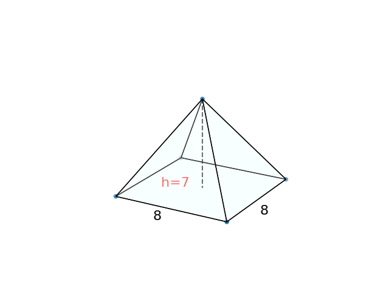

# AVP1358 — Single visual target

MathVista:499 / DynaMath:129 · different type · Numeric representation and conversion

## Shared or similar visual information

The numerical notation 7.

## Evidence locations

- Left image: The notation 7 appears near C between CB and CD.
- Right image: The notation 7 appears in the label h = 7 next to the vertical interior dashed segment.

## Mathematical meanings

Left image: 7 names the angle between the diagonal and right edge at C. Right image: 7 gives the perpendicular height of the pyramid.

## Same mathematical meanings

no

## Rationales

The notation on the left represents an angle identifier. The notation on the right represents a height.

Only the selected target is annotated. AI visual-review draft; not independently double-annotated by humans.
