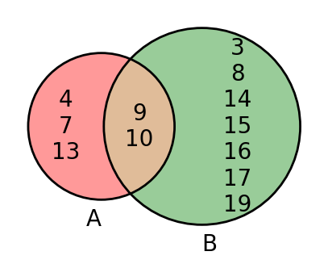
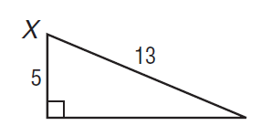

# AVP1359 — Single visual target

DynaMath:473 / MathVista:333 · different type · Numeric representation and conversion

## Shared or similar visual information

The numerical notation 13.

## Evidence locations

- Left image: The notation 13 appears inside the A-only region.
- Right image: The notation 13 appears next to the sloping edge.

## Mathematical meanings

Left image: 13 belongs to A only. Right image: 13 gives the hypotenuse length.

## Same mathematical meanings

no

## Rationales

The notation on the left represents an element of one set. The notation on the right represents a hypotenuse length.

Only the selected target is annotated. AI visual-review draft; not independently double-annotated by humans.
