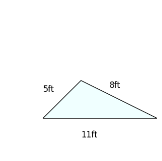

# AVP1362 — Single visual target

DynaMath:70 / DynaMath:470 · different type · Numeric representation and conversion

## Shared or similar visual information

The numerical notations 5 ft (left) and 5 (right).

## Evidence locations

- Left image: The notation 5 ft appears beside the left slanted side.
- Right image: The notation 5 appears inside the overlap of circles A and B.

## Mathematical meanings

Left image: 5 ft measures the left slanted side of the triangle. Right image: 5 is an element common to sets A and B.

## Same mathematical meanings

no

## Rationales

The notation on the left represents a segment length. The notation on the right represents an element of both sets.

Only the selected target is annotated. AI visual-review draft; not independently double-annotated by humans.
