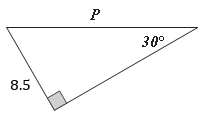
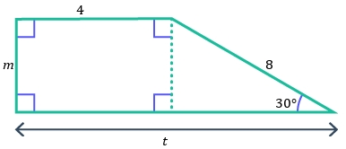

# AVP1364 — Single visual target

MathVerse:373 / MathVerse:379 · same type · Numeric representation and conversion

## Shared or similar visual information

The numerical notation 30°.

## Evidence locations

- Left image: The notation 30° appears beside the upper-right corner.
- Right image: The notation 30° appears beside the wedge at the right tip.

## Mathematical meanings

Left image: 30° measures the acute angle at that corner. Right image: 30° measures the acute angle at the right tip.

## Same mathematical meanings

yes

## Rationales

Each notation is placed next to the marked angle and specifies the same angle measure of 30°.

Only the selected target is annotated. AI visual-review draft; not independently double-annotated by humans.
