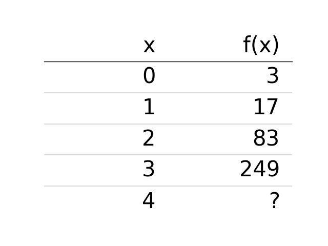
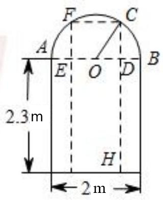

# AVP1365 — Single visual target

DynaMath:108 / MV-MATH:1203_2 · different type · Numeric representation and conversion

## Shared or similar visual information

The numerical notations 2 (left) and 2 m (right).

## Evidence locations

- Left image: The notation 2 appears the third data row of the x column.
- Right image: The notation 2 m appears below the horizontal dimension arrow.

## Mathematical meanings

Left image: 2 is the input at which the table gives f(x) = 83. Right image: 2 m measures the width of the arched outline across the bottom.

## Same mathematical meanings

no

## Rationales

The notation on the left represents a tabulated input value. The notation on the right represents a segment length.

Only the selected target is annotated. AI visual-review draft; not independently double-annotated by humans.
