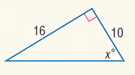

# AVP1367 — Single visual target

DynaMath:469 / MathVista:678 · different type · Numeric representation and conversion

## Shared or similar visual information

The numerical notation 10.

## Evidence locations

- Left image: The notation 10 appears at the bottom of the B-only region.
- Right image: The notation 10 appears beside the shorter leg of the triangle.

## Mathematical meanings

Left image: 10 belongs to B only. Right image: 10 gives the length of the shorter leg.

## Same mathematical meanings

no

## Rationales

The notation on the left represents an element of one set. The notation on the right represents a segment length.

Only the selected target is annotated. AI visual-review draft; not independently double-annotated by humans.
