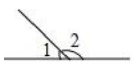
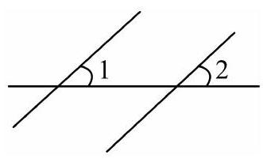

# AVP1368 — Single visual target

MV-MATH:1015_1 / MV-MATH:471_1 · same type · Numeric representation and conversion

## Shared or similar visual information

The bare numeral 2.

## Evidence locations

- Left image: The notation 2 appears above the arc to the right of the ray.
- Right image: The notation 2 appears at the right crossing above the transversal.

## Mathematical meanings

Left image: 2 names the right marked angle at the vertex. Right image: 2 identifies the marked angle at the right crossing.

## Same mathematical meanings

yes

## Rationales

The bare numeral 2 is associated with an angle in both drawings and identifies which angle is referenced.

Only the selected target is annotated. AI visual-review draft; not independently double-annotated by humans.
