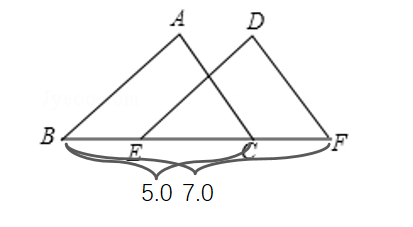
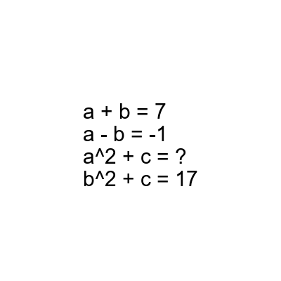

# AVP1369 — Single visual target

MathVerse:8 / DynaMath:499 · different type · Numeric representation and conversion

## Shared or similar visual information

The numerical notations 7.0 (left) and 7 (right).

## Evidence locations

- Left image: The notation 7.0 appears under the right brace spanning BF.
- Right image: The notation 7 appears on the right of a + b = 7.

## Mathematical meanings

Left image: 7.0 gives the full horizontal distance BF. Right image: 7 is the value of the sum a + b.

## Same mathematical meanings

no

## Rationales

The notation on the left represents a segment length. The notation on the right represents a value on the right of an equation.

Only the selected target is annotated. AI visual-review draft; not independently double-annotated by humans.
