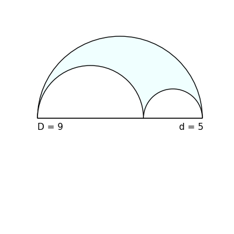
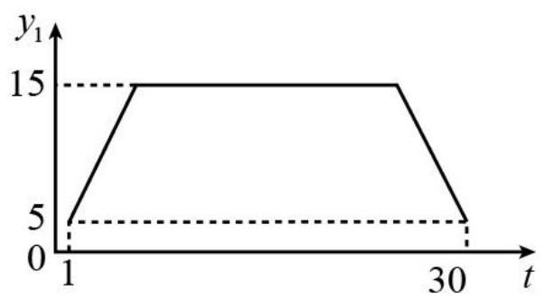

# AVP1373 — Single visual target

DynaMath:122 / MV-MATH:101_1 · different type · Numeric representation and conversion

## Shared or similar visual information

The numerical notation 5.

## Evidence locations

- Left image: The notation 5 appears in d = 5 at the right end of the horizontal base.
- Right image: The notation 5 appears on the y₁-axis at the lower dashed level.

## Mathematical meanings

Left image: 5 is the diameter indicated by d. Right image: 5 is the output shared by the first and last points.

## Same mathematical meanings

no

## Rationales

The notation on the left represents a diameter length. The notation on the right represents a vertical coordinate.

Only the selected target is annotated. AI visual-review draft; not independently double-annotated by humans.
