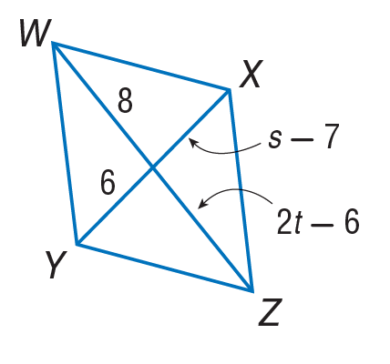
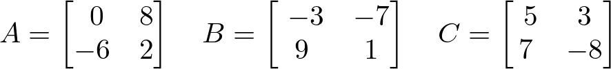

# AVP1374 — Single visual target

MathVista:819 / DynaMath:489 · different type · Numeric representation and conversion

## Shared or similar visual information

The numerical notation 8.

## Evidence locations

- Left image: The notation 8 appears on the upper-left piece of diagonal WZ.
- Right image: The notation 8 appears top-right cell of matrix A.

## Mathematical meanings

Left image: 8 labels the indicated segment length. Right image: 8 is the top-right entry of A.

## Same mathematical meanings

no

## Rationales

The notation on the left represents a segment length. The notation on the right represents a matrix entry.

Only the selected target is annotated. AI visual-review draft; not independently double-annotated by humans.
