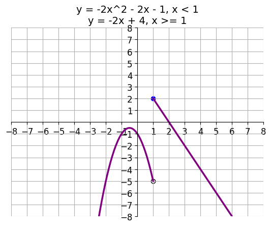
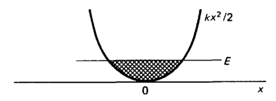

# AVP1375 — Single visual target

DynaMath:87 / MathVista:997 · same type · Numeric representation and conversion

## Shared or similar visual information

The exponent 2 in the expressions x^2 and x².

## Evidence locations

- Left image: The notation x^2 appears in the first branch formula with coefficient −2.
- Right image: The notation x² appears in kx²/2 to the right of the curve.

## Mathematical meanings

Left image: The variable x is squared in the first branch expression. Right image: The variable x is squared in the expression for the parabolic curve.

## Same mathematical meanings

yes

## Rationales

The exponent 2 applies squaring to the base shown in each formula.

Only the selected target is annotated. AI visual-review draft; not independently double-annotated by humans.
