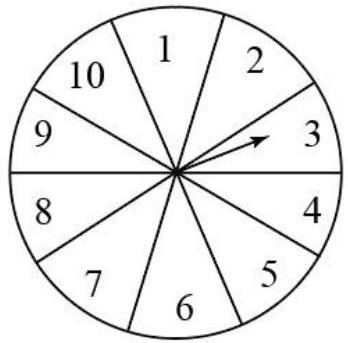
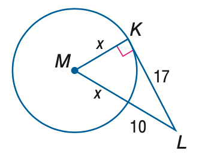

# AVP1377 — Single visual target

MV-MATH:510_1 / MathVista:114 · different type · Numeric representation and conversion

## Shared or similar visual information

The numerical notation 10.

## Evidence locations

- Left image: The notation 10 appears inside the upper-left sector of the spinner.
- Right image: The notation 10 appears next to the external part of the lower slanted segment.

## Mathematical meanings

Left image: 10 labels one possible spinner outcome. Right image: 10 gives the length of the exterior secant segment.

## Same mathematical meanings

no

## Rationales

The notation on the left represents a possible spinner outcome. The notation on the right represents a segment length.

Only the selected target is annotated. AI visual-review draft; not independently double-annotated by humans.
