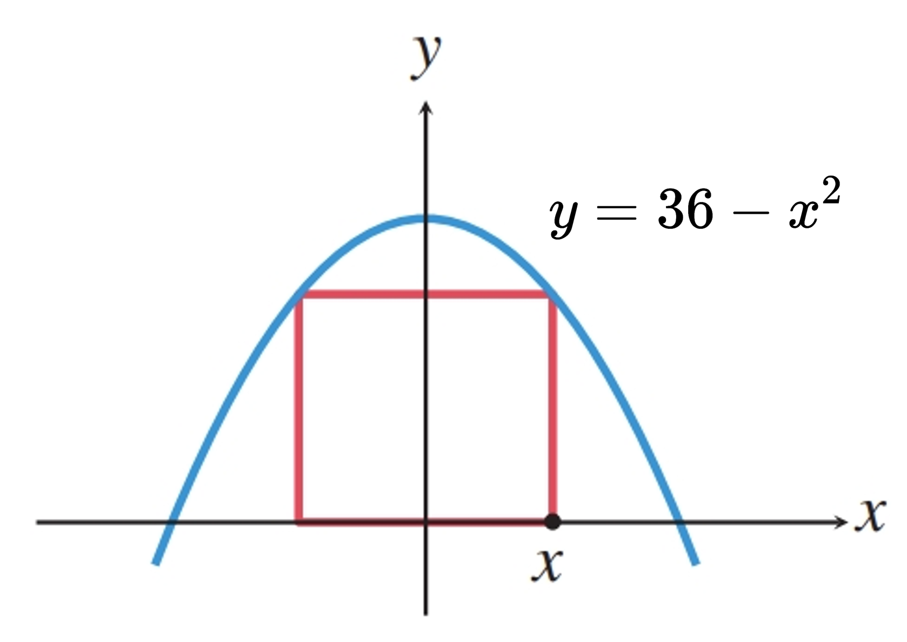

# AVP1378 — Single visual target

MathVista:671 / MathVerse:600 · same type · Numeric representation and conversion

## Shared or similar visual information

The exponent 2 in the expressions (x − 3)² and x².

## Evidence locations

- Left image: The notation (x − 3)² appears within the radical in the formula above the semicircle.
- Right image: The notation x² appears in the formula y = 36 − x².

## Mathematical meanings

Left image: The difference x − 3 is squared under the radical. Right image: The variable x is squared in the term subtracted from 36.

## Same mathematical meanings

yes

## Rationales

The exponent 2 applies squaring to the base shown in each formula.

Only the selected target is annotated. AI visual-review draft; not independently double-annotated by humans.
