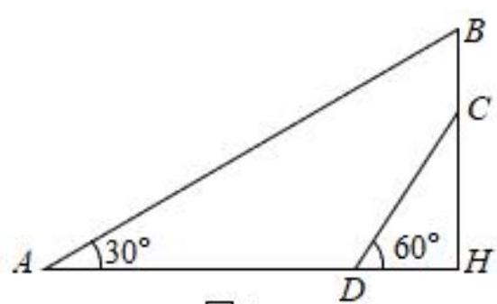
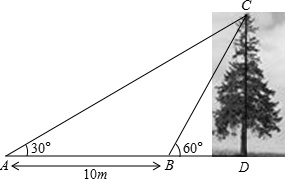

# AVP1380 — Single visual target

MV-MATH:1874_2 / MathVista:523 · same type · Numeric representation and conversion

## Shared or similar visual information

The numerical notation 30°.

## Evidence locations

- Left image: The notation 30° appears beside the arc at A.
- Right image: The notation 30° appears beside the wedge at A.

## Mathematical meanings

Left image: 30° gives the measure of the angle between AB and AH. Right image: 30° measures the angle from the baseline toward the top of the tree at the farther observation point.

## Same mathematical meanings

yes

## Rationales

Each notation is placed next to the marked angle and specifies the same angle measure of 30°.

Only the selected target is annotated. AI visual-review draft; not independently double-annotated by humans.
