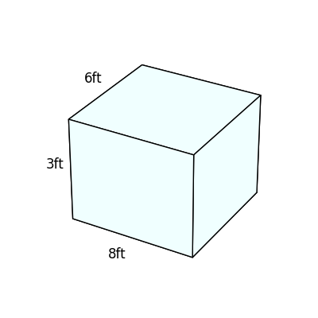
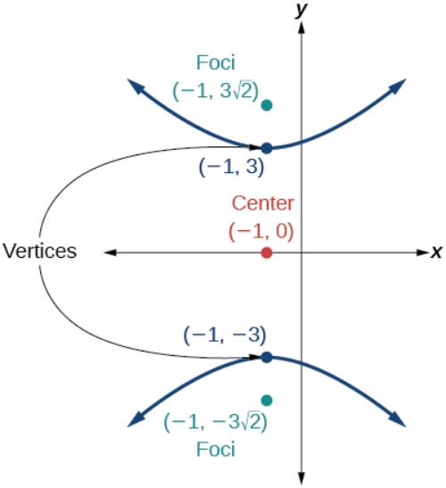

# AVP1382 — Single visual target

DynaMath:36 / MathVerse:437 · different type · Numeric representation and conversion

## Shared or similar visual information

The numerical notations 3 ft (left) and 3 (right).

## Evidence locations

- Left image: The notation 3 ft appears beside the left vertical edge.
- Right image: The notation 3 appears second component of the upper vertex label (−1, 3).

## Mathematical meanings

Left image: 3 ft gives the vertical height of the rectangular prism. Right image: 3 is the vertical coordinate of the upper hyperbola vertex.

## Same mathematical meanings

no

## Rationales

The notation on the left represents a segment length. The notation on the right represents a vertical coordinate.

Only the selected target is annotated. AI visual-review draft; not independently double-annotated by humans.
