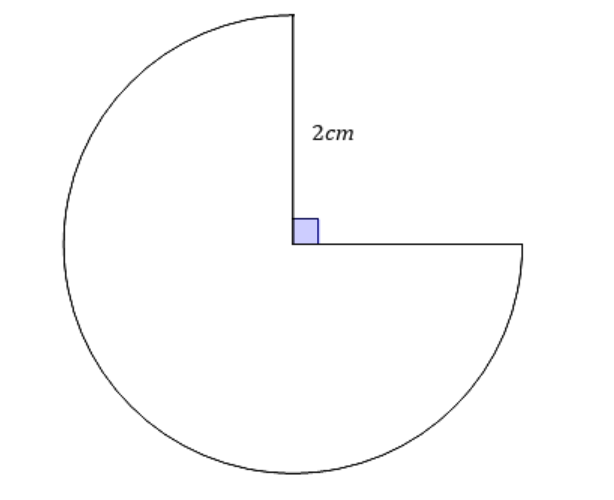
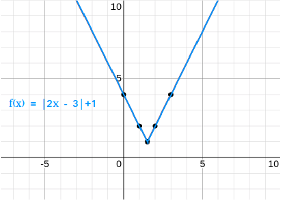

# AVP1384 — Single visual target

MathVerse:394 / MathVista:23 · different type · Numeric representation and conversion

## Shared or similar visual information

The numerical notations 2 cm (left) and 2 (right).

## Evidence locations

- Left image: The notation 2 cm appears beside the vertical radius.
- Right image: The notation 2 appears in the term 2x within the absolute value bars.

## Mathematical meanings

Left image: 2 cm is the radius of the circular outline. Right image: 2 multiplies x in the function formula.

## Same mathematical meanings

no

## Rationales

The notation on the left represents a radius length in centimeters. The notation on the right represents a variable coefficient.

Only the selected target is annotated. AI visual-review draft; not independently double-annotated by humans.
