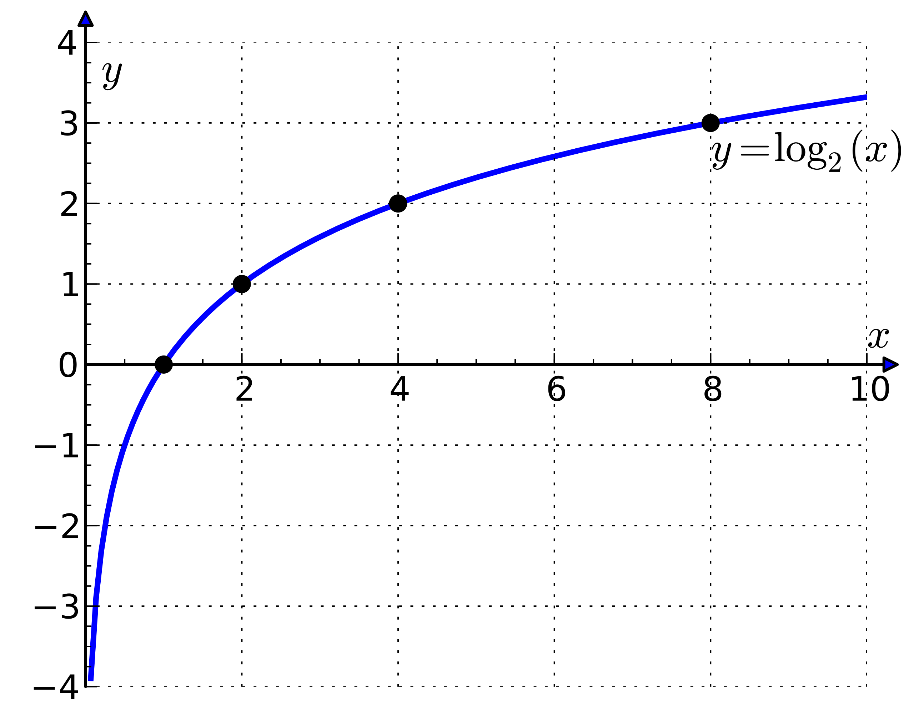
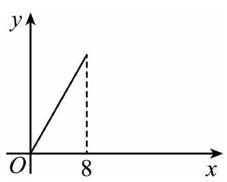

# AVP1385 — Single visual target

MathVista:329 / MV-MATH:103_1 · same type · Numeric representation and conversion

## Shared or similar visual information

The numerical notation 8.

## Evidence locations

- Left image: The notation 8 appears on the horizontal axis directly below the rightmost dot.
- Right image: The notation 8 appears beneath the vertical dashed projection.

## Mathematical meanings

Left image: 8 gives the horizontal coordinate of the marked point. Right image: 8 is the horizontal coordinate of the line segment's upper endpoint.

## Same mathematical meanings

yes

## Rationales

The numeral gives the same horizontal coordinate in both images.

Only the selected target is annotated. AI visual-review draft; not independently double-annotated by humans.
