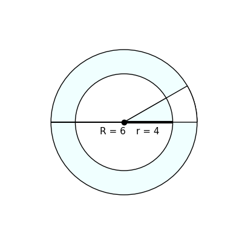
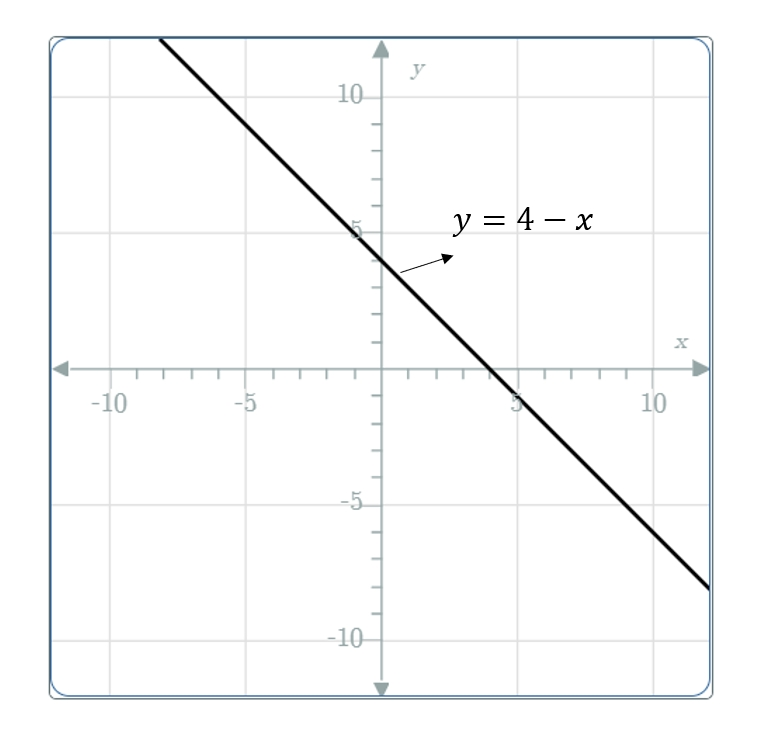

# AVP1389 — Single visual target

DynaMath:113 / MathVerse:626 · different type · Numeric representation and conversion

## Shared or similar visual information

The numerical notation 4.

## Evidence locations

- Left image: The notation 4 appears in r = 4 along the diameter line.
- Right image: The notation 4 appears in the formula y = 4 − x.

## Mathematical meanings

Left image: 4 is the inner circle radius. Right image: 4 is the constant term of the linear expression.

## Same mathematical meanings

no

## Rationales

The notation on the left represents a radius length. The notation on the right represents a constant term.

Only the selected target is annotated. AI visual-review draft; not independently double-annotated by humans.
