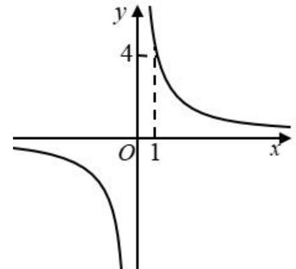
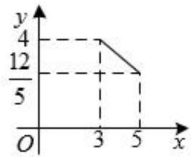

# AVP1390 — Single visual target

MV-MATH:952_1 / MV-MATH:96_1 · same type · Numeric representation and conversion

## Shared or similar visual information

The numerical notation 4.

## Evidence locations

- Left image: The notation 4 appears left of the y-axis at the guide level.
- Right image: The notation 4 appears on the y-axis beside the upper horizontal guide.

## Mathematical meanings

Left image: 4 is the vertical coordinate of the point indicated by the guide. Right image: 4 is the height of the segment's left endpoint.

## Same mathematical meanings

yes

## Rationales

The numeral gives the same vertical coordinate in both images.

Only the selected target is annotated. AI visual-review draft; not independently double-annotated by humans.
