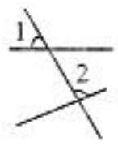
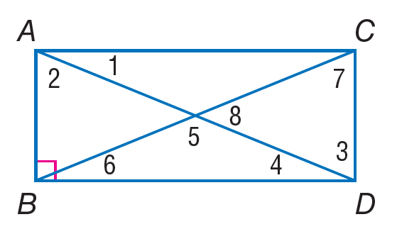

# AVP1391 — Single visual target

MV-MATH:761_1 / MathVista:499 · same type · Numeric representation and conversion

## Shared or similar visual information

The bare numeral 1.

## Evidence locations

- Left image: The notation 1 appears next to the upper intersection arc.
- Right image: The notation 1 appears near A between AC and AD.

## Mathematical meanings

Left image: 1 names the upper marked angle. Right image: 1 names the angle between the top edge and diagonal at A.

## Same mathematical meanings

yes

## Rationales

The bare numeral 1 is associated with an angle in both drawings and identifies which angle is referenced.

Only the selected target is annotated. AI visual-review draft; not independently double-annotated by humans.
