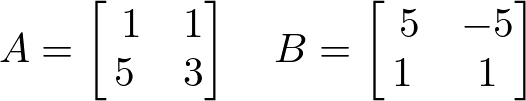
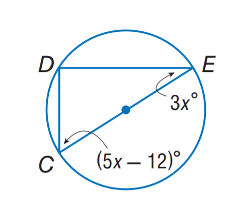

# AVP1393 — Single visual target

DynaMath:485 / MathVista:951 · different type · Numeric representation and conversion

## Shared or similar visual information

The numerical notation 3.

## Evidence locations

- Left image: The notation 3 appears bottom-right cell of matrix A.
- Right image: The notation 3 appears in the angle expression 3x° beside E.

## Mathematical meanings

Left image: 3 is the bottom-right entry of A. Right image: 3 multiplies x in the angle expression at E.

## Same mathematical meanings

no

## Rationales

The notation on the left represents a matrix entry. The notation on the right represents a variable coefficient.

Only the selected target is annotated. AI visual-review draft; not independently double-annotated by humans.
