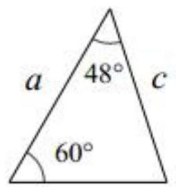
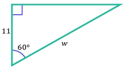

# AVP1396 — Single visual target

MV-MATH:973_1 / MathVerse:371 · same type · Numeric representation and conversion

## Shared or similar visual information

The numerical notation 60°.

## Evidence locations

- Left image: The notation 60° appears next to the arc at the left base vertex.
- Right image: The notation 60° appears beside the arc at the lower-left vertex.

## Mathematical meanings

Left image: 60° measures the interior angle at the left base vertex. Right image: 60° measures the acute angle at that vertex.

## Same mathematical meanings

yes

## Rationales

Each notation is placed next to the marked angle and specifies the same angle measure of 60°.

Only the selected target is annotated. AI visual-review draft; not independently double-annotated by humans.
