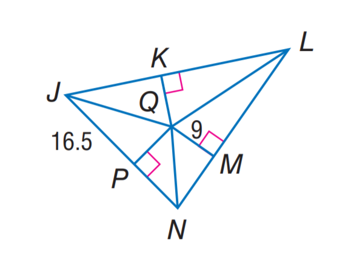
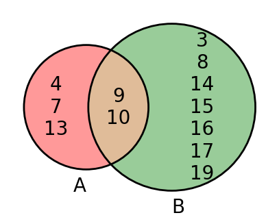

# AVP1397 — Single visual target

MathVista:776 / DynaMath:473 · different type · Numeric representation and conversion

## Shared or similar visual information

The numerical notation 9.

## Evidence locations

- Left image: The notation 9 appears next to QM.
- Right image: The notation 9 appears inside the central overlap.

## Mathematical meanings

Left image: 9 gives the perpendicular distance from Q to side NL. Right image: 9 belongs to both A and B.

## Same mathematical meanings

no

## Rationales

The notation on the left represents a segment length. The notation on the right represents an element of both sets.

Only the selected target is annotated. AI visual-review draft; not independently double-annotated by humans.
