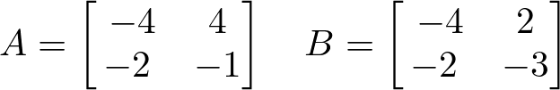
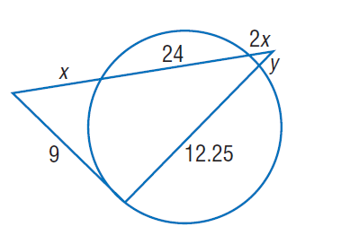

# AVP1400 — Single visual target

DynaMath:475 / MathVista:816 · different type · Numeric representation and conversion

## Shared or similar visual information

The numerical notation 2.

## Evidence locations

- Left image: The notation 2 appears top-right cell of matrix B.
- Right image: The notation 2 appears in 2x beside the upper-right end of the secant.

## Mathematical meanings

Left image: 2 is the top-right entry of B. Right image: 2 multiplies x in the expression 2x.

## Same mathematical meanings

no

## Rationales

The notation on the left represents a matrix entry. The notation on the right represents a variable coefficient.

Only the selected target is annotated. AI visual-review draft; not independently double-annotated by humans.
