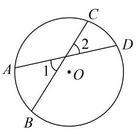
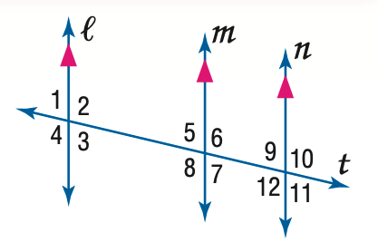

# AVP1401 — Single visual target

MV-MATH:221_1 / MathVista:938 · same type · Numeric representation and conversion

## Shared or similar visual information

The bare numeral 2.

## Evidence locations

- Left image: The notation 2 appears beside the upper-right arc at the chord intersection.
- Right image: The notation 2 appears upper-right wedge at the left crossing.

## Mathematical meanings

Left image: 2 names the selected angle at the chord intersection. Right image: 2 names the indicated angle at that crossing.

## Same mathematical meanings

yes

## Rationales

The bare numeral 2 is associated with an angle in both drawings and identifies which angle is referenced.

Only the selected target is annotated. AI visual-review draft; not independently double-annotated by humans.
