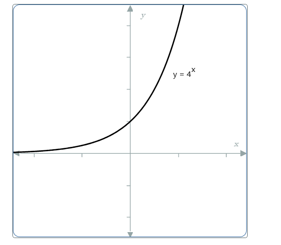
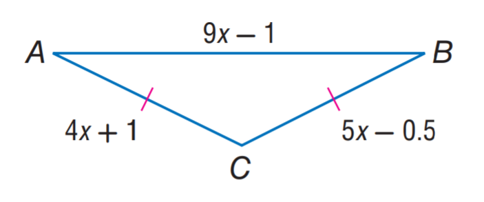

# AVP1403 — Single visual target

MathVerse:516 / MathVista:375 · different type · Numeric representation and conversion

## Shared or similar visual information

The numerical notation 4.

## Evidence locations

- Left image: The notation 4 appears in the formula y = 4ˣ.
- Right image: The notation 4 appears in 4x + 1 on the left side of the triangle.

## Mathematical meanings

Left image: 4 is the base of the exponential expression. Right image: 4 multiplies x in the length expression for AC.

## Same mathematical meanings

no

## Rationales

The notation on the left represents an exponential base. The notation on the right represents a variable coefficient.

Only the selected target is annotated. AI visual-review draft; not independently double-annotated by humans.
