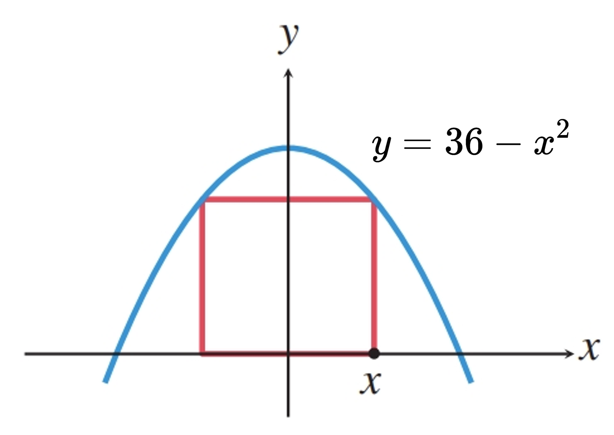
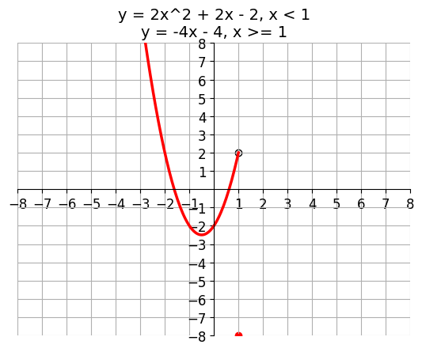

# AVP1404 — Single visual target

MathVerse:600 / DynaMath:88 · same type · Numeric representation and conversion

## Shared or similar visual information

The exponent 2 in the expressions x² and x^2.

## Evidence locations

- Left image: The notation x² appears in the formula y = 36 − x².
- Right image: The notation x^2 appears in the first branch formula with coefficient 2.

## Mathematical meanings

Left image: The variable x is squared in the term subtracted from 36. Right image: The variable x is squared in the first branch expression.

## Same mathematical meanings

yes

## Rationales

The exponent 2 applies squaring to the base shown in each formula.

Only the selected target is annotated. AI visual-review draft; not independently double-annotated by humans.
