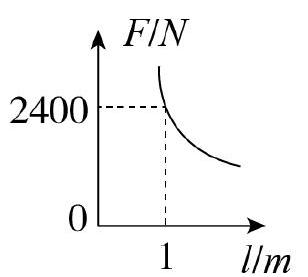
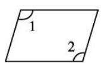

# AVP1407 — Single visual target

MV-MATH:79_1 / MV-MATH:1027_1 · different type · Numeric representation and conversion

## Shared or similar visual information

The numerical notation 1.

## Evidence locations

- Left image: The notation 1 appears at the foot of the dashed guide on the horizontal axis labeled l/m.
- Right image: The notation 1 appears beside the upper-left arc of the parallelogram.

## Mathematical meanings

Left image: 1 m is the length input corresponding to the indicated force. Right image: 1 names the marked upper-left angle.

## Same mathematical meanings

no

## Rationales

The notation on the left represents a length input in meters. The notation on the right represents an angle identifier.

Only the selected target is annotated. AI visual-review draft; not independently double-annotated by humans.
