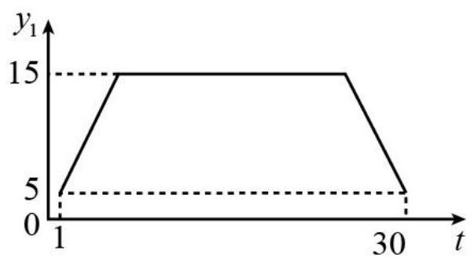
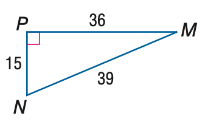

# AVP1409 — Single visual target

MV-MATH:101_1 / MathVista:388 · different type · Numeric representation and conversion

## Shared or similar visual information

The numerical notation 15.

## Evidence locations

- Left image: The notation 15 appears on the y₁-axis at the level of the plateau.
- Right image: The notation 15 appears beside PN.

## Mathematical meanings

Left image: 15 gives the output along the plateau. Right image: 15 gives the length of the vertical leg PN.

## Same mathematical meanings

no

## Rationales

The notation on the left represents a vertical coordinate. The notation on the right represents a segment length.

Only the selected target is annotated. AI visual-review draft; not independently double-annotated by humans.
