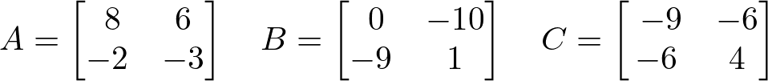
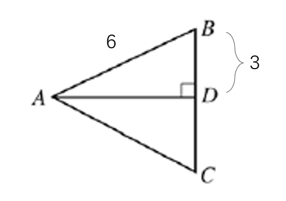

# AVP1411 — Single visual target

DynaMath:487 / MathVerse:758 · different type · Numeric representation and conversion

## Shared or similar visual information

The numerical notation 6.

## Evidence locations

- Left image: The notation 6 appears top-right cell of matrix A.
- Right image: The notation 6 appears beside AB.

## Mathematical meanings

Left image: 6 is the top-right entry of A. Right image: 6 gives AB, the hypotenuse of right triangle ADB.

## Same mathematical meanings

no

## Rationales

The notation on the left represents a matrix entry. The notation on the right represents a hypotenuse length.

Only the selected target is annotated. AI visual-review draft; not independently double-annotated by humans.
