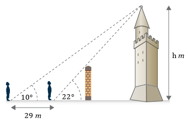
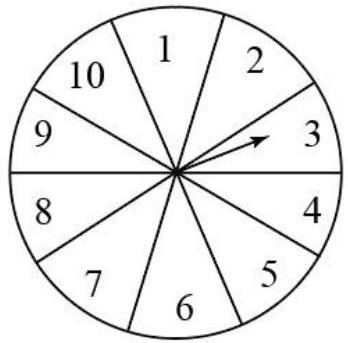

# AVP1413 — Single visual target

MathVerse:361 / MV-MATH:510_1 · different type · Numeric representation and conversion

## Shared or similar visual information

The numerical notations 10° (left) and 10 (right).

## Evidence locations

- Left image: The notation 10° appears beside the dashed arc near the left observer.
- Right image: The notation 10 appears inside the upper-left sector of the spinner.

## Mathematical meanings

Left image: 10° measures the angle of elevation from the left observation point. Right image: 10 labels one possible spinner outcome.

## Same mathematical meanings

no

## Rationales

The notation on the left represents an angle measure. The notation on the right represents a possible spinner outcome.

Only the selected target is annotated. AI visual-review draft; not independently double-annotated by humans.
