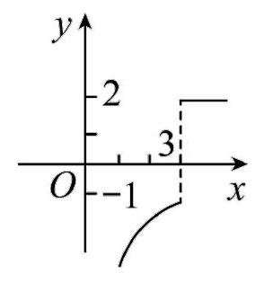
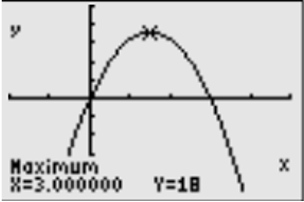

# AVP1414 — Single visual target

MV-MATH:94_1 / MathVista:217 · same type · Numeric representation and conversion

## Shared or similar visual information

The numerical notations 3 (left) and 3.000000 (right).

## Evidence locations

- Left image: The notation 3 appears beside the vertical dashed guide on the horizontal axis.
- Right image: The notation 3.000000 appears in the calculator display under the word Maximum.

## Mathematical meanings

Left image: 3 sets the horizontal coordinate of the guide. Right image: 3.000000 gives the x-coordinate where the calculator finds a maximum.

## Same mathematical meanings

yes

## Rationales

3 and 3.000000 denote equal values, and both give a horizontal coordinate.

Only the selected target is annotated. AI visual-review draft; not independently double-annotated by humans.
