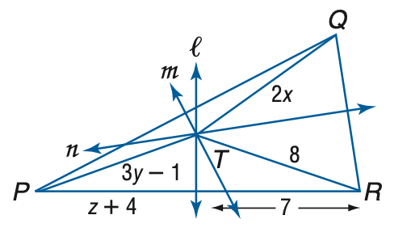

# AVP1415 — Single visual target

MathVista:575 / DynaMath:470 · different type · Numeric representation and conversion

## Shared or similar visual information

The numerical notation 7.

## Evidence locations

- Left image: The notation 7 appears below the right-hand horizontal dimension arrow.
- Right image: The notation 7 appears at the top of the B-only region.

## Mathematical meanings

Left image: 7 gives the indicated base distance. Right image: 7 belongs to B only.

## Same mathematical meanings

no

## Rationales

The notation on the left represents a segment length. The notation on the right represents an element of one set.

Only the selected target is annotated. AI visual-review draft; not independently double-annotated by humans.
