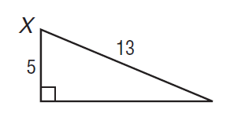

# AVP1417 — Single visual target

MathVista:333 / DynaMath:469 · different type · Numeric representation and conversion

## Shared or similar visual information

The numerical notation 13.

## Evidence locations

- Left image: The notation 13 appears next to the sloping edge.
- Right image: The notation 13 appears inside the overlap of circles A and B.

## Mathematical meanings

Left image: 13 gives the hypotenuse length. Right image: 13 is an element common to sets A and B.

## Same mathematical meanings

no

## Rationales

The notation on the left represents a hypotenuse length. The notation on the right represents an element of both sets.

Only the selected target is annotated. AI visual-review draft; not independently double-annotated by humans.
