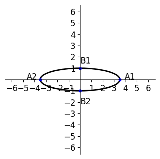

# AVP1421 — Single visual target

VisioMath:56_A / DynaMath:176 · different type · Mathematical roles of graphical elements

[Left image in official archive](https://raw.githubusercontent.com/Nefefilibata/VisioMath/4a912153e110001da261917902e1d3cc163b7c6a/data/images.zip) · `images/56_A.jpg`

## Shared or similar visual information

An oval drawn with an unbroken outline.

## Evidence locations

- Left image: The continuous oval at the upper end of the cylinder.
- Right image: The closed curve through the four vertices, with B1 and B2 at y = 1 and −1.

## Mathematical meanings

Left image: The oval represents the circular rim of the upper face of a cylinder in perspective. Right image: The oval is the plane ellipse with a shorter vertical than horizontal semiaxis.

## Same mathematical meanings

no

## Rationales

The feature shows a circular rim of a solid in perspective in the left image and traces a plane ellipse on the axes in the right image. The continuous oval at the upper end of the cylinder. The closed curve through the four vertices, with B1 and B2 at y = 1 and −1.

Only the selected target is annotated. AI visual-review draft; not independently double-annotated by humans.
