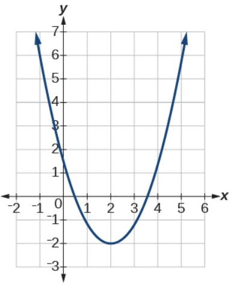
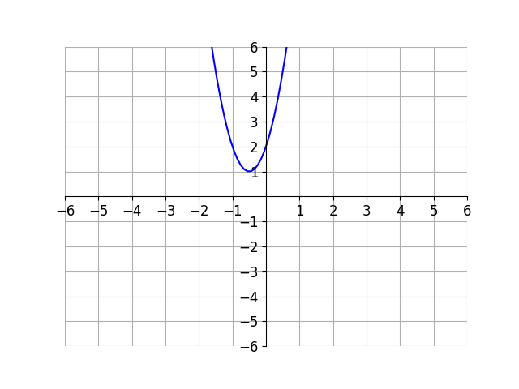

# AVP1427 — Single visual target

MathVerse:500 / DynaMath:61 · same type · Mathematical roles of graphical elements

## Shared or similar visual information

A smooth U-shaped curve.

## Evidence locations

- Left image: The U-shaped blue trace with its low point at x = 2.
- Right image: The narrow blue U-shaped graph with its vertex just left of the y-axis.

## Mathematical meanings

Left image: The curve plots a function with a minimum near (2, −2). Right image: The curve plots a function whose output is lowest at the bottom of the U.

## Same mathematical meanings

yes

## Rationales

In both images the feature traces a function that reaches its lowest output at the bottom of the U. The U-shaped blue trace with its low point at x = 2. The narrow blue U-shaped graph with its vertex just left of the y-axis.

Only the selected target is annotated. AI visual-review draft; not independently double-annotated by humans.
