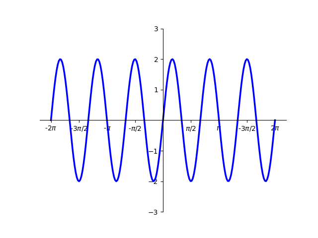
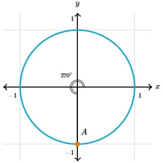

# AVP1429 — Single visual target

DynaMath:1 / MathVerse:524 · different type · Mathematical roles of graphical elements

## Shared or similar visual information

The horizontal coordinate axis.

## Evidence locations

- Left image: The horizontal coordinate line crossed repeatedly by the blue wave.
- Right image: The horizontal coordinate line through the origin above the point A.

## Mathematical meanings

Left image: The horizontal axis supplies the input coordinate of the periodic function. Right image: The axis gives the horizontal coordinate in the plane containing the unit circle.

## Same mathematical meanings

yes

## Rationales

In both images the feature measures the horizontal Cartesian coordinate. The horizontal coordinate line crossed repeatedly by the blue wave. The horizontal coordinate line through the origin above the point A.

Only the selected target is annotated. AI visual-review draft; not independently double-annotated by humans.
