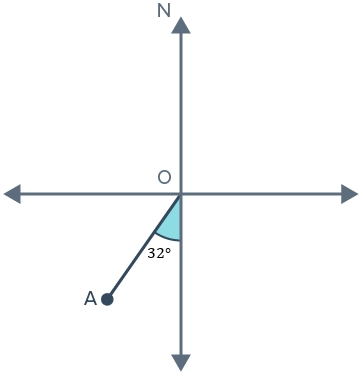

# AVP1430 — Single visual target

VisioMath:311_A / MathVerse:335 · same type · Mathematical roles of graphical elements

[Left image in official archive](https://raw.githubusercontent.com/Nefefilibata/VisioMath/4a912153e110001da261917902e1d3cc163b7c6a/data/images.zip) · `images/311_A.jpg`

## Shared or similar visual information

A shaded region.

## Evidence locations

- Left image: The gray parallelogram interior surrounding the white circular cutout.
- Right image: The cyan wedge next to 32° at O.

## Mathematical meanings

Left image: The shading selects the area of the parallelogram after removing the disk. Right image: The shading highlights the angle between the downward reference direction and OA.

## Same mathematical meanings

no

## Rationales

The feature selects a geometric area in the left image and highlights the angle between two rays in the right image. The gray parallelogram interior surrounding the white circular cutout. The cyan wedge next to 32° at O.

Only the selected target is annotated. AI visual-review draft; not independently double-annotated by humans.
