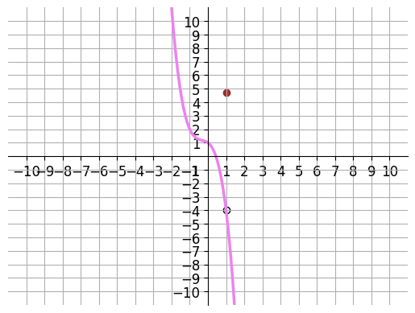

# AVP1432 — Single visual target

DynaMath:143 / MathVerse:484 · same type · Mathematical roles of graphical elements

## Shared or similar visual information

A filled circular point marker.

## Evidence locations

- Left image: The filled red point at x = 1, above the hollow point on the curve.
- Right image: The filled cyan point at (−5, 2), where the curve ends on the left.

## Mathematical meanings

Left image: The dot supplies the function value at the x-coordinate where the smooth trace has a hole. Right image: The dot includes the left endpoint (−5, 2) in the function graph.

## Same mathematical meanings

no

## Rationales

The feature specifies an isolated included ordered pair off the nearby curve in the left image and marks an endpoint included in the plotted branch in the right image. The filled red point at x = 1, above the hollow point on the curve. The filled cyan point at (−5, 2), where the curve ends on the left.

Only the selected target is annotated. AI visual-review draft; not independently double-annotated by humans.
