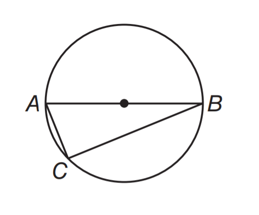

# AVP1433 — Single visual target

VisioMath:1115_A / MathVista:28 · different type · Mathematical roles of graphical elements

[Left image in official archive](https://raw.githubusercontent.com/Nefefilibata/VisioMath/4a912153e110001da261917902e1d3cc163b7c6a/data/images.zip) · `images/1115_A.jpg`

## Shared or similar visual information

An unfilled circular outline.

## Evidence locations

- Left image: The hollow circle at the lower right end of the short descending segment.
- Right image: The circular outline through A, B and C.

## Mathematical meanings

Left image: The hollow circle excludes the ordered pair at the right endpoint of the segment. Right image: The outline is the circumference of the circle whose diameter is AB.

## Same mathematical meanings

no

## Rationales

The feature marks an ordered pair excluded from the plotted trace in the left image and traces the circumference of a geometric circle in the right image. The hollow circle at the lower right end of the short descending segment. The circular outline through A, B and C.

Only the selected target is annotated. AI visual-review draft; not independently double-annotated by humans.
