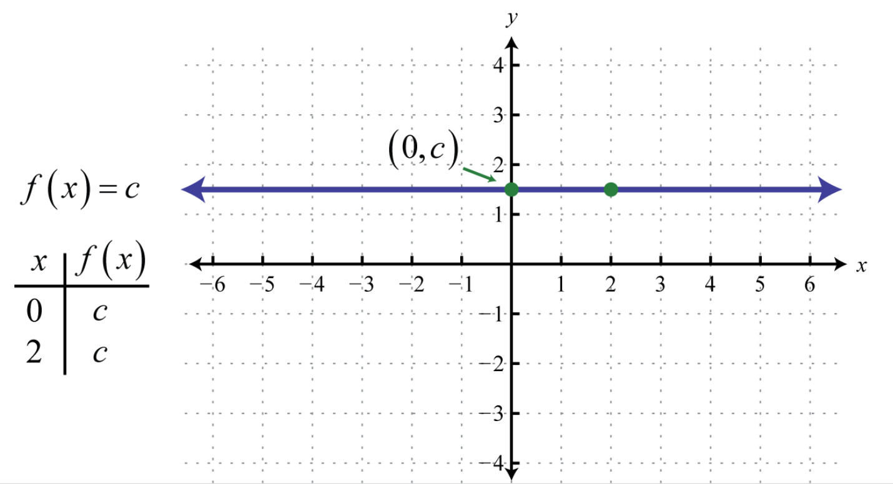
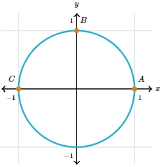

# AVP1434 — Single visual target

MathVista:223 / MathVerse:528 · different type · Mathematical roles of graphical elements

## Shared or similar visual information

The horizontal coordinate axis.

## Evidence locations

- Left image: The horizontal numbered axis through the leftmost marked point.
- Right image: The horizontal line through C and A and the center of the unit circle.

## Mathematical meanings

Left image: The axis measures the input coordinate of the logarithmic plot. Right image: The axis is the horizontal coordinate reference for the geometry diagram.

## Same mathematical meanings

yes

## Rationales

In both images the feature measures the horizontal Cartesian coordinate. The horizontal numbered axis through the leftmost marked point. The horizontal line through C and A and the center of the unit circle.

Only the selected target is annotated. AI visual-review draft; not independently double-annotated by humans.
