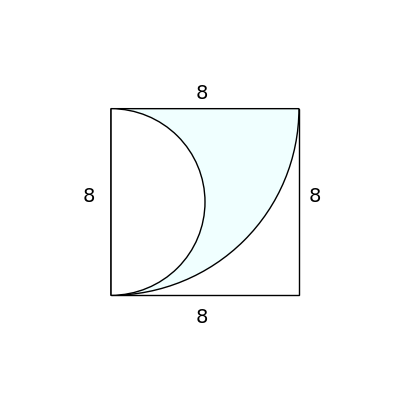
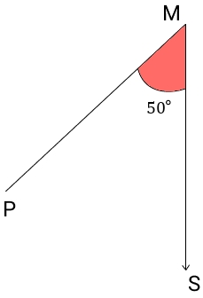

# AVP1437 — Single visual target

DynaMath:112 / MathVerse:332 · same type · Mathematical roles of graphical elements

## Shared or similar visual information

A shaded region.

## Evidence locations

- Left image: The pale blue patch between the semicircle and the arc inside the square.
- Right image: The red wedge at M between MP and MS.

## Mathematical meanings

Left image: The shading selects the area inside the arc and outside the semicircle within the square. Right image: The shading highlights the 50° angle between MP and MS.

## Same mathematical meanings

no

## Rationales

The feature selects a geometric area in the left image and highlights the angle between two rays in the right image. The pale blue patch between the semicircle and the arc inside the square. The red wedge at M between MP and MS.

Only the selected target is annotated. AI visual-review draft; not independently double-annotated by humans.
