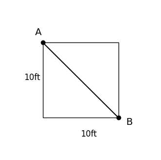
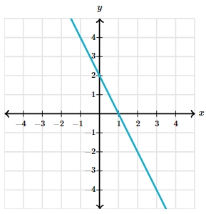

# AVP1439 — Single visual target

DynaMath:80 / MathVerse:591 · different type · Mathematical roles of graphical elements

## Shared or similar visual information

A solid straight line descending from left to right.

## Evidence locations

- Left image: The descending segment joining A to B within the square.
- Right image: The cyan falling line crossing the y-axis at 2 and x-axis at 1.

## Mathematical meanings

Left image: The segment is the diagonal joining opposite square vertices. Right image: The straight trace plots a decreasing linear function.

## Same mathematical meanings

no

## Rationales

The feature connects opposite vertices of a quadrilateral in the left image and plots a linear relationship between coordinates in the right image. The descending segment joining A to B within the square. The cyan falling line crossing the y-axis at 2 and x-axis at 1.

Only the selected target is annotated. AI visual-review draft; not independently double-annotated by humans.
