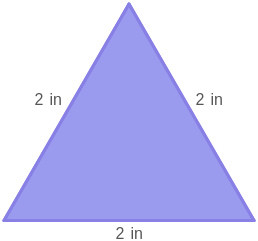
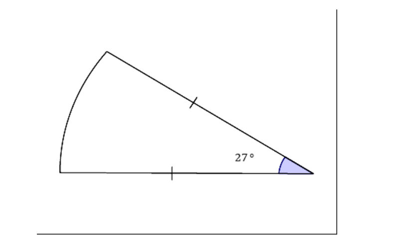

# AVP1445 — Single visual target

MathVista:399 / MathVerse:413 · same type · Mathematical roles of graphical elements

## Shared or similar visual information

A shaded region.

## Evidence locations

- Left image: The lavender triangle with three 2 in side labels.
- Right image: The lavender wedge at the right-hand junction of the two radii.

## Mathematical meanings

Left image: The shading designates the entire area inside the equilateral triangle. Right image: The shading highlights the 27° central angle between the radii.

## Same mathematical meanings

no

## Rationales

The feature selects a geometric area in the left image and highlights the angle between two rays in the right image. The lavender triangle with three 2 in side labels. The lavender wedge at the right-hand junction of the two radii.

Only the selected target is annotated. AI visual-review draft; not independently double-annotated by humans.
