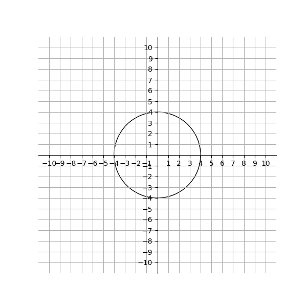
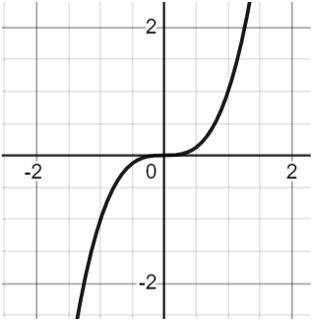

# AVP1446 — Single visual target

DynaMath:213 / MathVista:120 · different type · Mathematical roles of graphical elements

## Shared or similar visual information

The horizontal coordinate axis.

## Evidence locations

- Left image: The numbered horizontal line through the middle of the grid.
- Right image: The x-axis at height zero across the black S-shaped graph.

## Mathematical meanings

Left image: The axis gives the horizontal coordinate in the plane containing the circle. Right image: The axis measures the horizontal input coordinate.

## Same mathematical meanings

yes

## Rationales

In both images the feature measures the horizontal Cartesian coordinate. The numbered horizontal line through the middle of the grid. The x-axis at height zero across the black S-shaped graph.

Only the selected target is annotated. AI visual-review draft; not independently double-annotated by humans.
