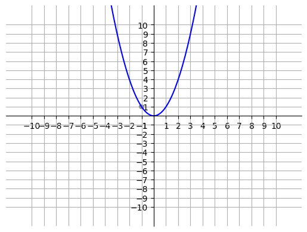

# AVP1448 — Single visual target

VisioMath:16_A / DynaMath:46 · same type · Mathematical roles of graphical elements

[Left image in official archive](https://raw.githubusercontent.com/Nefefilibata/VisioMath/4a912153e110001da261917902e1d3cc163b7c6a/data/images.zip) · `images/16_A.jpg`

## Shared or similar visual information

A smooth U-shaped curve.

## Evidence locations

- Left image: The U-shaped curve tangent to the horizontal axis at x = −1.
- Right image: The blue U-shaped trace near the middle of the grid.

## Mathematical meanings

Left image: The curve plots a function with its minimum at (−1, 0). Right image: The curve plots a function whose lowest output is at the bottom of the U.

## Same mathematical meanings

yes

## Rationales

In both images the feature traces a function that reaches its lowest output at the bottom of the U. The U-shaped curve tangent to the horizontal axis at x = −1. The blue U-shaped trace near the middle of the grid.

Only the selected target is annotated. AI visual-review draft; not independently double-annotated by humans.
