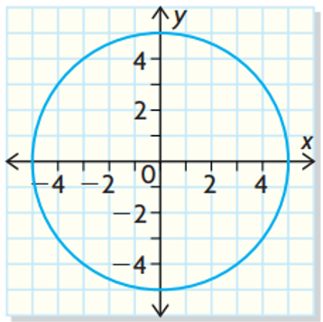

# AVP1451 — Single visual target

VisioMath:107_A / MathVista:409 · different type · Mathematical roles of graphical elements

[Left image in official archive](https://raw.githubusercontent.com/Nefefilibata/VisioMath/4a912153e110001da261917902e1d3cc163b7c6a/data/images.zip) · `images/107_A.jpg`

## Shared or similar visual information

The horizontal coordinate axis.

## Evidence locations

- Left image: The x-axis running through O and crossing the rising line.
- Right image: The x-axis near the horizontal middle of the square grid.

## Mathematical meanings

Left image: The axis measures the horizontal coordinate in the plotted relationship. Right image: The axis measures horizontal Cartesian position for the plotted circle.

## Same mathematical meanings

yes

## Rationales

In both images the feature measures the horizontal Cartesian coordinate. The x-axis running through O and crossing the rising line. The x-axis near the horizontal middle of the square grid.

Only the selected target is annotated. AI visual-review draft; not independently double-annotated by humans.
