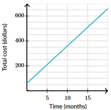

# AVP1454 — Single visual target

VisioMath:1022_A / MathVerse:594 · same type · Mathematical roles of graphical elements

[Left image in official archive](https://raw.githubusercontent.com/Nefefilibata/VisioMath/4a912153e110001da261917902e1d3cc163b7c6a/data/images.zip) · `images/1022_A.jpg`

## Shared or similar visual information

A solid straight line rising from left to right.

## Evidence locations

- Left image: The rising diagonal crossing the x-axis left of O.
- Right image: The rising cyan line on the total-cost versus time plot.

## Mathematical meanings

Left image: The line plots a positive-slope linear function. Right image: The line shows that total cost rises at a constant rate with time.

## Same mathematical meanings

yes

## Rationales

In both images the feature plots a linear relationship between coordinates. The rising diagonal crossing the x-axis left of O. The rising cyan line on the total-cost versus time plot.

Only the selected target is annotated. AI visual-review draft; not independently double-annotated by humans.
