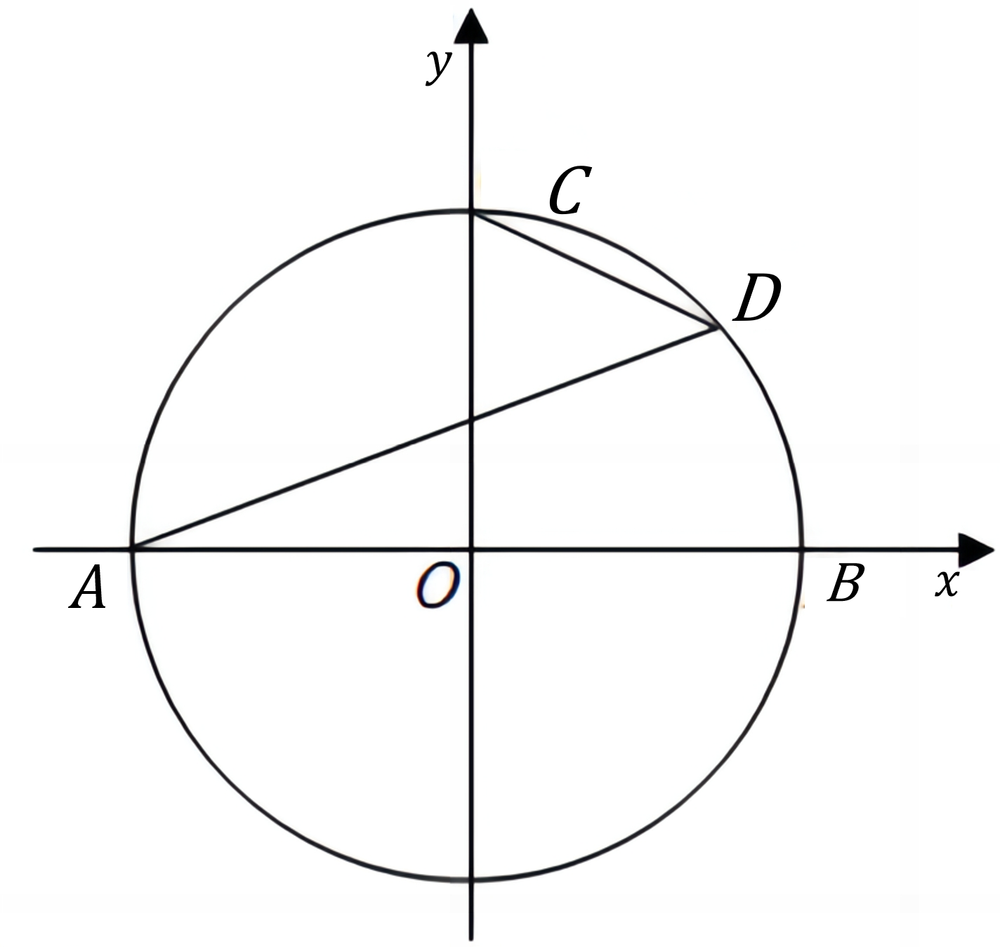
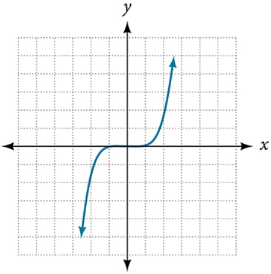

# AVP1455 — Single visual target

DynaMath:55 / MathVerse:477 · different type · Mathematical roles of graphical elements

## Shared or similar visual information

The horizontal coordinate axis.

## Evidence locations

- Left image: The rightward x-axis through O, A and B.
- Right image: The x-axis through the flat section of the blue cubic-shaped curve.

## Mathematical meanings

Left image: The axis serves as the horizontal Cartesian reference through the circle’s center. Right image: The axis measures horizontal Cartesian position for the function.

## Same mathematical meanings

yes

## Rationales

In both images the feature measures the horizontal Cartesian coordinate. The rightward x-axis through O, A and B. The x-axis through the flat section of the blue cubic-shaped curve.

Only the selected target is annotated. AI visual-review draft; not independently double-annotated by humans.
